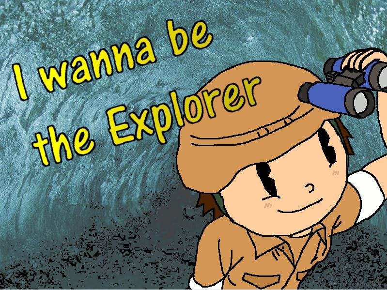

# I wanna be the Explorer

A 2D platformer written in Python with [pygame](https://www.pygame.org/). You play an explorer who has to get
through a series of levels full of obstacles and a final boss level against a dragon. It was a team project
for the university course *Informatik Werkstatt*.



## Features

- 15 levels plus a boss level, each with its own layout, obstacles and graphics
- Double jump, three lives per run and checkpoints
- Coins to collect. If you run out of lives, you can buy an extra life for 2 coins
- Shooting in the boss level and in some other levels
- Pause menu, music mute button, sound effects and a controls menu

## Controls

| Key | Action |
|---|---|
| Left / right arrow | Move |
| Up arrow | Jump (press again in the air for a second jump) |
| Space | Shoot (only in certain levels) |

## Running the game

You need Python 3 and pygame:

```
pip install pygame
python Game.py
```

Start the game from this folder, because the images and sounds are loaded with relative paths. The game starts
in fullscreen mode, so use the in-game **EXIT GAME** button to quit.

## Project structure

| Path | Contents |
|---|---|
| `Game.py` | Entry point: menus, main loop, pause and game over screens |
| `Level.py`, `Level1.py` … `Level16.py`, `Bosslevel.py` | Base level class and the individual levels |
| `Player.py`, `Shot.py`, `Obstacle.py`, `Coin.py`, `SavePosition.py` | Game objects |
| `Menu.py`, `Button.py`, `Button2.py`, `AudioSettings.py` | Menus, buttons and sound |
| `level*pics/`, `playerPics/`, `obstaclesPics/`, `Bosslevel/`, `coinspics/`, `volumeicons/` | Graphics |
| `audio/` | Sound effects and background music |
